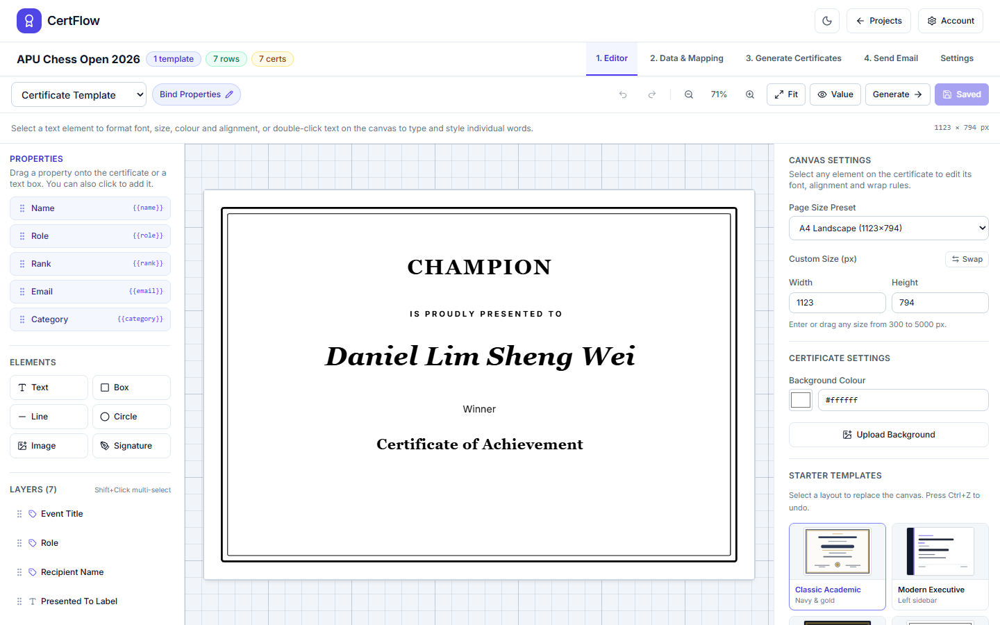

# CertFlow

Design certificate templates, import recipient spreadsheets, generate personalised certificates in bulk and email them from one workspace.

CertFlow is built for event organisers, clubs, schools and competitions that issue certificates to participants, speakers, committees and prize winners.

[](https://github.com/FishyWeed/CertFlow/releases/latest)
[](https://github.com/FishyWeed/CertFlow/releases/latest)
[](https://github.com/FishyWeed/CertFlow/releases/latest)
[](https://cert-flow.up.railway.app)
[](https://github.com/FishyWeed/CertFlow/actions/workflows/ci.yml)



---

## One-Click Launch (No Coding Required)

### Option 1: Windows Desktop Installer (Recommended on Windows)

Install CertFlow to any folder with a Desktop shortcut, Start Menu entry and silent system tray launcher (no terminal window, no Node.js or Docker required and no local project or storage limits):

[](https://github.com/FishyWeed/CertFlow/releases/latest)

1. Open the [latest GitHub Release](https://github.com/FishyWeed/CertFlow/releases/latest) and download `CertFlow-vX.Y.Z-win-x64-Setup.exe`.
2. Run the installer, choose any destination folder (CertFlow installs inside a `CertFlow` folder) and leave **Create a Desktop shortcut** ticked.
3. Launch **CertFlow** from your Desktop shortcut or Start Menu. Your browser opens `http://localhost:3000` automatically while `CertFlow.exe` runs quietly in your Windows system tray.
4. Right-click the tray icon at any time to **Open CertFlow**, **Open in App Window**, **Open Data Folder**, **View Server Log** or **Quit CertFlow**.
5. Check for and install future releases directly from **Account Settings -> Portable App Updates** without touching your `data/` folder.

### Option 2: Portable Desktop ZIP (Windows, macOS, Linux)

Run CertFlow offline from any folder or USB drive with zero dependencies installed:

[](https://github.com/FishyWeed/CertFlow/releases/latest)

1. Open [GitHub Releases](https://github.com/FishyWeed/CertFlow/releases/latest) and download the ZIP for your computer:
   - Windows: `CertFlow-vX.Y.Z-win-x64.zip`
   - macOS (Apple Silicon): `CertFlow-vX.Y.Z-darwin-arm64.zip`
   - macOS (Intel): `CertFlow-vX.Y.Z-darwin-x64.zip`
   - Linux: `CertFlow-vX.Y.Z-linux-x64.zip`
2. Unzip the folder anywhere (Desktop, Documents or a USB drive).
3. Launch CertFlow:
   - **Windows**: Double-click **`CertFlow.exe`** (silent tray launcher) or **`Start-CertFlow.bat`** (console view). Double-click **`Create-Desktop-Shortcut.bat`** to add a Desktop shortcut.
   - **macOS**: Double-click **`Start-CertFlow.command`**.
   - **Linux**: Run **`./start-certflow.sh`**.
4. Your browser opens `http://localhost:3000` automatically. Enter your name, email and password, then click **Start CertFlow**.

All settings, projects, embedded database files and uploaded images stay inside the `data/` folder next to the launcher and relocate automatically if you move the folder.

### Option 3: Deploy on Render

Deploy a private cloud copy of CertFlow with a PostgreSQL database and auto-generated security keys in one click:

[](https://render.com/deploy?repo=https://github.com/FishyWeed/CertFlow)

1. Click **Deploy to Render** and sign in with GitHub or Google.
2. Click **Apply** and wait about 2 minutes for the build to finish.
3. Open your new CertFlow link and create your account.

> **Note on Render Free Tier**: Free Render web services reset local uploaded files when redeployed. For permanent uploaded backgrounds and logos, upgrade to a persistent disk on Render or deploy on Railway below.

### Option 4: Deploy on Railway

Deploy CertFlow on Railway with PostgreSQL and a persistent Volume mounted at `/data/uploads`:

[](https://railway.com/new)

1. Click **Deploy on Railway** and choose **Deploy from GitHub repo** -> `FishyWeed/CertFlow`.
2. Add a **PostgreSQL** service and a persistent **Volume** mounted at `/data/uploads`.
3. Follow the environment variable steps in [Deployment (Railway)](#deployment-railway) to finish setup.

> **Maintainer note for 1-click stack provisioning**: Open the CertFlow project in Railway, go to **Project Settings -> General -> Create Template**, replace personal values for `BETTER_AUTH_SECRET` and `ENCRYPTION_KEY` with `${{secret(64)}}` and publish the template. Then replace `https://railway.com/new` in the button above with `https://railway.com/new/template/<TEMPLATE_CODE>` so Railway provisions CertFlow, PostgreSQL, the Volume and secrets in one click.

### Option 5: Docker on Desktop or Server

If you already use Docker Desktop or host on a VPS or NAS:

[](https://github.com/FishyWeed/CertFlow/pkgs/container/certflow)

- **Instant prebuilt image (fastest)**: Run `docker compose -f docker-compose.ghcr.yml up -d` to pull `ghcr.io/fishyweed/certflow:latest`.
- **Build from source**: Clone this repository and run `docker compose up -d --build`.
- Open `http://localhost:3000` and finish the `/setup` wizard. Technical users can expand **Advanced Settings** on `/setup` to customise keys, connect an external PostgreSQL database or set a server-wide email relay.

---

## What You Can Do

### Visual Certificate Editor
- **Unified top formatting toolbar**: Control font family, font size, bold, italic, underline, colour, alignment (`left`, `centre`, `right`, `justify`), vertical alignment, case, line spacing, wrap mode and canvas centring (`Centre: Horizontal | Vertical`) from one top bar.
- **Direct on-canvas WYSIWYG editing**: Double-click any text element on the certificate to type directly on canvas and highlight individual words to style font, size, weight, underline or colour live without raw formatting tags.
- **Optical centring and shrink-only box sizing**: Text centres optically inside its bounding box; expanding a box never enlarges font sizes past their set sizes, and shrinking a box scales mixed-size text proportionally only when needed to fit.
- **114 built-in fonts**: Browse and search serif, calligraphy, sans-serif, ceremonial display, slab serif and monospace fonts with live typeface previews.
- **Dynamic Properties and rules**: Insert `{{name}}`, `{{role}}`, `{{rank}}` or any spreadsheet column into text boxes and add conditional rules to switch wording automatically.
- **Gridded sandbox and layout tools**: Start marquee drag-selection from the gridded sandbox outside the certificate or inside empty canvas space, use smart alignment and equal-spacing snap guides, group elements, drag line endpoints, crop images and draw or upload signatures.
- **Flexible canvas sizes**: Choose from 13 print and digital presets (A4, A5, A3, US Letter, 16:9, 1:1) or enter custom dimensions.

### Spreadsheet Data and Automatic Routing
- **Import and export spreadsheets**: Upload `.csv`, `.xlsx` or `.xls` files, edit rows in the built-in table and export the table back to `.csv` at any time.
- **Edit and organise data**: Search rows, drag to rearrange rows or columns, add custom columns and sort or filter any column from its header.
- **Automatic template matching**: Create multiple templates in one project (such as Participant, Organiser and Champion) and route recipients automatically by Role, Rank or any Property.

### Bulk Certificate Generation and Export
- **Live certificate preview**: Inspect every recipient's rendered certificate side by side with an expandable full-size view.
- **Per-recipient edits**: Override a recipient's name, role, rank, email or assigned template without editing the original spreadsheet.
- **Unified Export menu**: Download the selected certificate as **PNG**, **JPG** or **PDF**, or export all filtered certificates together in a **ZIP** archive organised by role.

### Bulk Email Delivery
- **Four sender profile modes with built-in setup guides**: Connect **Brevo** (free 300/day with Gmail or custom domain), **Resend** (free 100/day with custom domain), **Custom SMTP Server** (Gmail App Password, Outlook, Zoho or private mail on local/self-hosted installs) or **Custom Reply-To** (shared server relay) in **Account Settings**.
- **Saved drafts and safe tracking**: Write personalised subjects and messages with `{{property}}` placeholders, save drafts per project, skip recipients without email addresses automatically and track send history in **Recent Send Runs**.
- **Unlimited local usage**: Local installations (Windows Installer, Portable ZIP, local Docker and local dev) lift the hosted cloud project, storage, upload size and recipient caps automatically.

## Quick Walkthrough

1. **Create a project**: Sign in, open the dashboard and create a project for your event.
2. **1. Editor**: Upload a background, arrange text, logos, shapes and signatures, then save your templates.
3. **2. Data & Mapping**: Import your CSV or Excel file (or add rows manually) and check the **Matched Template** column.
4. **3. Generate Certificates**: Click **Generate from Dataset**, review live previews and use **Export** to download single files or a ZIP archive.
5. **4. Send Email**: Choose a sender profile, write and save your draft, then send certificates to every recipient with an email address.

## Editor Keyboard Shortcuts

| Shortcut | Action |
| :--- | :--- |
| `Ctrl+Z` / `Ctrl+Shift+Z` (`Ctrl+Y`) | Undo or redo the last change |
| `Ctrl+S` | Save the active template, data table or email draft |
| `Ctrl+C` / `Ctrl+X` / `Ctrl+V` | Copy, cut or paste selected elements |
| `Ctrl+D` | Duplicate selected elements |
| `Ctrl+G` / `Ctrl+Shift+G` | Group or ungroup selected elements |
| `Ctrl+A` | Select all unlocked elements on the canvas |
| `Arrow keys` (`Shift+Arrow`) | Move selected elements by 1 px (or 10 px) |
| `Delete` / `Backspace` | Delete selected elements |
| `Shift` while dragging a line endpoint | Snap the line angle to 15-degree steps |

---

## Technical Overview

CertFlow runs on SvelteKit 3, Svelte 5, PostgreSQL (Drizzle ORM + embedded `PGlite` for local/portable runs), Better Auth, Konva, `pdf-lib`, `jszip` and Nodemailer.

## Self-Hosting with Docker (One-Click Setup Wizard)

Anyone can launch CertFlow in Docker without editing `.env` files manually. On first launch, CertFlow opens a built-in `/setup` wizard to configure your URL, security secrets, database, optional email provider and first account.

### Option A: Docker Compose with PostgreSQL (Recommended)

1. Start CertFlow and PostgreSQL:
   ```bash
   docker compose up -d
   ```
2. Open `http://localhost:3000` in your browser.
3. Complete the **Setup Wizard** (strong session and AES-256 keys are pre-generated, and the PostgreSQL URL is pre-filled).
4. Configuration, uploaded images and database data persist in Docker volumes (`certflow_data` and `certflow_pgdata`). Once completed, `/setup` locks permanently.

### Option B: Single Container (Embedded PostgreSQL)

1. Build and run one standalone container with zero external services:
   ```bash
   docker build -t certflow .
   docker run -d --name certflow -p 3000:3000 -v certflow_data:/data certflow
   ```
2. Open `http://localhost:3000`, choose **Embedded PostgreSQL** in `/setup` and finish creating your account.

## Local Development (No Docker Required)

Local development uses embedded PostgreSQL (`PGlite` in `./.local/pgdata`) and a local email outbox (`./.local/outbox/`). You do not need Docker or external accounts to run the app.

1. Install the packages:
   ```bash
   pnpm install
   ```
2. If `.env` does not exist, copy `.env.example` to `.env`:
   ```bash
   cp .env.example .env
   ```
3. Push the PostgreSQL schema:
   ```bash
   pnpm db:push
   ```
4. Start the local development server:
   ```bash
   pnpm dev
   ```
5. Open `http://localhost:5678` in your browser.

## Optional: Local Mailpit Test Inbox

If you want a local catch-all SMTP inbox (`http://localhost:8025`) during development, run:

```bash
docker compose --profile dev-mail up -d mailpit
```

## Common Commands

| Command | Purpose |
| :--- | :--- |
| `pnpm dev` | Start the local SvelteKit development server |
| `pnpm db:push` | Synchronise the Drizzle schema to PostgreSQL (`PGlite` or remote Postgres) |
| `pnpm db:studio` | Open the Drizzle visual database browser |
| `pnpm run verify` | Run all pipeline checks, unit tests, type checks and production build |
| `pnpm test` | Run Vitest unit tests |
| `pnpm check` | Run `svelte-kit sync` and `svelte-check` |
| `pnpm build` | Build production Node server bundle |
| `pnpm start` | Run the built production server (`scripts/start.mjs`) |
| `pnpm run docker:up` | Build and start local Docker Compose stack |
| `pnpm run docker:ghcr` | Start prebuilt GHCR Docker Compose stack |
| `pnpm run release:portable` | Package portable ZIP bundles for Windows, macOS and Linux |

## Deployment (Railway)

CertFlow includes `@sveltejs/adapter-node`, a `/api/health` endpoint and automatic PostgreSQL migrations on startup (`scripts/start.mjs` + `drizzle/`).

1. Push the repository to GitHub (`.env`, `.local/`, `uploads/`, `.tmp/` and `.ctx/` are ignored).
2. Create a new Railway project from your GitHub repository.
3. Add a **PostgreSQL** service in the same Railway project.
4. Attach a persistent **Volume** to the CertFlow service mounted at `/data/uploads`.
5. Set these environment variables on the CertFlow service:
   - `DATABASE_URL`: `${{Postgres.DATABASE_URL}}`
   - `BETTER_AUTH_URL` and `PUBLIC_APP_URL`: your Railway HTTPS URL (for example `https://${{RAILWAY_PUBLIC_DOMAIN}}`)
   - `BETTER_AUTH_SECRET`: a fresh random 64-character hex secret
   - `ENCRYPTION_KEY`: a fresh random 64-character hex secret (keep this fixed after saving SMTP profiles)
   - `STORAGE_DRIVER`: `local`
   - `LOCAL_UPLOAD_DIR`: `/data/uploads`
   - **Free email delivery on Railway** (Railway Free/Hobby plans block outbound SMTP ports `465`/`587`, so use an HTTPS API over port `443`):
     - **Brevo** (free 300 emails/day, works with a verified Gmail address and no custom domain): set `BREVO_API_KEY` and `DEFAULT_FROM_EMAIL` (your verified Brevo sender email).
     - **Resend** (free 100 emails/day with a custom domain): set `RESEND_API_KEY` and `DEFAULT_FROM_EMAIL`.
6. Optionally set **Healthcheck Path** to `/api/health` in Railway service **Settings** -> **Deploy**.
7. Deploy — Railway runs `pnpm build` and `pnpm start`, which applies `drizzle/` migrations automatically before starting the Node server.

## Architecture and Guides

[](./STRUCTURE.md)
[](./docs/PIPELINES.md)
[](./docs/BLUEPRINT.md)
[](./docs/DEV_TRAIL.md)

- [STRUCTURE.md](./STRUCTURE.md) — Folder map and module placement rules.
- [docs/PIPELINES.md](./docs/PIPELINES.md) — All six development and delivery pipelines (Local, Railway, Render, Docker and Portable).
- [docs/BLUEPRINT.md](./docs/BLUEPRINT.md) — System architecture, tech stack, routes, limitations and roadmap.
- [docs/DEV_TRAIL.md](./docs/DEV_TRAIL.md) — Chronological development log and verified milestones.
