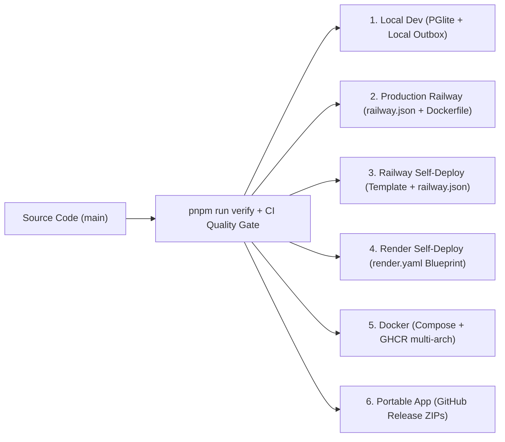

# CertFlow — Development and Delivery Pipelines

CertFlow uses one shared SvelteKit 3 + Node.js 22 codebase across six development and delivery pipelines. Every pipeline shares the same database schema (`drizzle/`), runtime config resolver (`src/lib/server/runtime-config.ts`) and verification gate (`pnpm run verify`).



---

## Pre-Push Quality Gate (All Pipelines)

Run one command before every commit or release:

```bash
pnpm run verify
```

This command runs four checks in order:
1. `pnpm run verify:pipelines` — validates Node script syntax, `Dockerfile` Railway compatibility, `railway.json`, `render.yaml`, Docker Compose stacks and GitHub Actions workflow files.
2. `pnpm test` — runs the Vitest unit test suite.
3. `pnpm run check` — runs `svelte-kit sync` and `svelte-check` (0 errors, 0 warnings).
4. `pnpm build` — builds the `@sveltejs/adapter-node` production bundle.

GitHub Actions (`.github/workflows/ci.yml`) runs this exact gate on every push and pull request to `main`.

---

## Pipeline 1: Developing Locally

**Goal:** Fast local iteration with zero Docker, zero external database and zero external email accounts.

| Aspect | Behaviour |
| :--- | :--- |
| Server | `pnpm dev` on `http://localhost:5678` |
| Database | Embedded PostgreSQL (`PGlite`) stored in `./.local/pgdata` |
| Email | Local JSON outbox in `./.local/outbox/` (optional Mailpit via `docker compose --profile dev-mail up -d mailpit`) |
| Uploads | Local disk in `./uploads` |
| Setup Wizard | Disabled (`CERTFLOW_SELF_HOSTED` is unset) |

**Commands:**
1. Install dependencies: `pnpm install`
2. If `.env` does not exist, copy `.env.example` to `.env`. Never commit `.env`.
3. Apply schema changes to local PGlite: `pnpm run db:push`
4. Start the dev server: `pnpm dev`
5. Generate SQL migrations after schema edits: `pnpm run db:generate`
6. Verify everything before pushing: `pnpm run verify`

---

## Pipeline 2: Production Deployment (Your Railway Instance)

**Goal:** Continuous deployment of `https://cert-flow.up.railway.app` from `main` without touching `.env` or Railway secrets.

| Aspect | Behaviour |
| :--- | :--- |
| Trigger | Automatic on every push to `main` |
| Config file | `railway.json` + `Dockerfile` |
| Start command | `node scripts/start.mjs` (runs `drizzle/` migrations, then boots `build/index.js`) |
| Healthcheck | `GET /api/health` (60-second timeout) |
| Database | Managed Railway PostgreSQL (`DATABASE_URL=${{Postgres.DATABASE_URL}}`) |
| Storage | Railway Volume mounted at `/data/uploads` (`STORAGE_DRIVER=local`, `LOCAL_UPLOAD_DIR=/data/uploads`) |
| Email | HTTPS API sender profiles (Brevo or Resend over port 443; Railway Free/Hobby blocks SMTP ports 465/587) |
| Setup Wizard | Disabled automatically (`RAILWAY_ENVIRONMENT` / `RAILWAY_PROJECT_ID` detected) |

**Rules for this pipeline:**
1. Never add a `VOLUME` directive to `Dockerfile` (Railway rejects it; `verify:pipelines` guards this).
2. Always generate and commit SQL migrations in `drizzle/` when changing `src/lib/server/db/schema.ts`.
3. Keep `BETTER_AUTH_SECRET`, `ENCRYPTION_KEY` and `DATABASE_URL` in Railway service variables only.
4. Confirm `SUCCESS` on the Railway deployment and `{"status":"ok"}` at `/api/health` after pushing.

---

## Pipeline 3: Developing for Others to Deploy on Railway

**Goal:** Allow any user to clone and host CertFlow on their own Railway account with minimal clicks.

| Aspect | Behaviour |
| :--- | :--- |
| Config-as-code | `railway.json` configures Dockerfile build, `node scripts/start.mjs`, `/api/health` and restart policy automatically |
| Auth origin | Auto-detected from `RAILWAY_PUBLIC_DOMAIN` if `BETTER_AUTH_URL` is omitted |
| Secret format | `crypto.ts` accepts both 64-character hex keys and arbitrary `${{secret(64)}}` cloud-generated strings |
| One-click Template | Created from Railway **Project Settings -> General -> Create Template** with `${{secret(64)}}` placeholders |

**Maintenance checklist when changing env vars or services:**
1. Update `railway.json` if build, start or healthcheck behaviour changes.
2. Update the Railway steps in `README.md` if a new required variable is added.
3. Update your published Railway Template if you add a new service or required variable.

---

## Pipeline 4: Developing for Others to Deploy on Render

**Goal:** True 1-click cloud deploy directly from GitHub using Render Blueprints (`render.yaml`).

| Aspect | Behaviour |
| :--- | :--- |
| Blueprint file | `render.yaml` (`certflow` Docker web service + `certflow-db` PostgreSQL database) |
| Auth origin | Auto-detected from `RENDER_EXTERNAL_URL` |
| Secrets | Auto-generated via `generateValue: true` (`BETTER_AUTH_SECRET`, `ENCRYPTION_KEY`) |
| Healthcheck | `GET /api/health` |
| Setup Wizard | Disabled automatically (`RENDER=true` / `RENDER_EXTERNAL_URL` detected) |
| Storage caveat | Render Free Tier resets `/data/uploads` on redeploy; paid Render Persistent Disk or S3/R2 persists uploads |

**Maintenance checklist:**
1. Keep `render.yaml` in sync with any new required environment variables.
2. Ensure `scripts/verify-pipelines.mjs` passes after any `render.yaml` or `Dockerfile` edit.
3. Keep `crypto.ts` SHA-256 derivation active so Render's base64-style `generateValue: true` secrets work without errors.

---

## Pipeline 5: Running Locally or on a Server via Docker

**Goal:** Self-hosted Docker execution with a first-run `/setup` wizard and zero manual `.env` editing.

| Mode | Command | Image Source | Database |
| :--- | :--- | :--- | :--- |
| Developer local build | `pnpm run docker:up` (`docker compose up -d --build`) | Builds local `Dockerfile` | PostgreSQL 18 container (`certflow_pgdata`) |
| Instant prebuilt pull | `pnpm run docker:ghcr` (`docker compose -f docker-compose.ghcr.yml up -d`) | `ghcr.io/fishyweed/certflow:latest` | PostgreSQL 18 container (`certflow_pgdata`) |
| Single standalone container | `docker run -d -p 3000:3000 -v certflow_data:/data ghcr.io/fishyweed/certflow:latest` | Prebuilt GHCR image | Embedded PostgreSQL (`PGlite` in `/data/pgdata`) |
| Desktop double-click | `Start-CertFlow.bat` (Windows) or `Start-CertFlow.command` (macOS) | Uses `docker-compose.yml` | PostgreSQL 18 container |

**Automated publishing:**
- `.github/workflows/docker-publish.yml` builds and pushes multi-arch (`linux/amd64`, `linux/arm64`) images to `ghcr.io/fishyweed/certflow` on every push to `main` and every `v*` tag.
- On first launch, `/setup` writes `/data/config.json` (mode `0600`), runs migrations, creates the first user account and permanently locks `/setup`.

---

## Pipeline 6: Running Locally as a Portable Desktop App

**Goal:** Zero-install `.zip` archive for non-technical users (no Docker, no Node.js, no database setup).

| Aspect | Behaviour |
| :--- | :--- |
| Packager | `scripts/package-portable.mjs` + `installer/certflow.iss` (Inno Setup 6 Windows Installer) |
| Targets | `win-x64` (`Setup.exe` + `.zip`), `darwin-arm64`, `darwin-x64`, `linux-x64` |
| Bundled runtime | Official Node.js 22 LTS single binary (`runtime/node.exe` or `runtime/bin/node`) |
| Dependencies | Flat zero-symlink hoisted production `node_modules` (`nodeLinker: hoisted`) |
| Database and storage | Embedded PostgreSQL (`PGlite`) + `config.json` + `uploads/` inside `data/` next to the launcher (unlimited projects and storage locally) |
| Launchers and shortcuts | `Start-CertFlow.bat`, `Create-Desktop-Shortcut.bat`, `Start-CertFlow.command`, `start-certflow.sh`, plus Desktop and Start Menu shortcuts from `Setup.exe` |
| Release workflow | `.github/workflows/release-portable.yml` (builds all 4 ZIPs on Ubuntu, then compiles `Setup.exe` on Windows) |

**How to test locally:**
```bash
pnpm build
pnpm run release:portable:win
```

**How to publish a new GitHub Release:**
1. Run `pnpm run verify` and push your changes to `main`.
2. Create and push a version tag:
   ```bash
   git tag -a v1.1.0 -m "CertFlow v1.1.0"
   git push origin v1.1.0
   ```
3. GitHub Actions automatically builds all four ZIP archives, publishes them to GitHub Releases and tags `ghcr.io/fishyweed/certflow:1.1.0`.

---

## Pipeline Runtime Matrix

| Feature | Local Dev | Railway (Prod / Self) | Render | Docker | Portable ZIP |
| :--- | :--- | :--- | :--- | :--- | :--- |
| Database | PGlite | Managed Postgres | Managed Postgres | Postgres 18 or PGlite | PGlite |
| Uploads | `./uploads` | `/data/uploads` Volume | Ephemeral (Free) / Disk | `certflow_data` Volume | `./data/uploads` |
| First-run `/setup` | Off | Off | Off | On (locks after setup) | On (locks after setup) |
| Custom Raw SMTP | Allowed | Hidden (ports blocked) | Hidden (ports blocked) | Allowed | Allowed |
| Brevo / Resend HTTPS API | Allowed | Allowed | Allowed | Allowed | Allowed |
| Local File Outbox | `./.local/outbox` | Off | Off | Only if unconfigured in dev | Only if unconfigured in dev |
